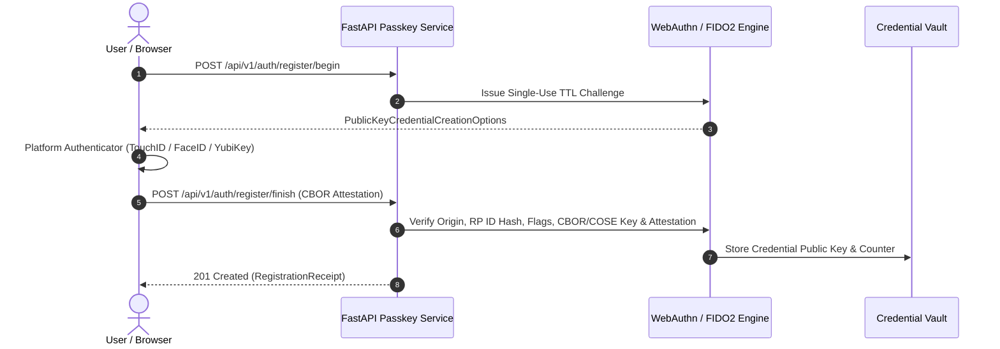

# Auth Passkey Service

[](https://github.com/txltedxgod/auth-passkey-service/actions)
[](https://opensource.org/licenses/MIT)
[](https://www.python.org/)
[](https://www.docker.com/)

Passwordless WebAuthn / FIDO2 authentication microservice in Python 3.11+ implementing RFC 8949 CBOR & COSE decoding, cryptographic signature verification (`ES256` P-256 & `EdDSA` Ed25519), single-use challenge protection, and anti-cloning `signCount` enforcement.



## Features
- **Cryptographic Verification**: Verifies `ES256` (`secp256r1` DER/IEEE P1363) and `EdDSA` (`Ed25519`) WebAuthn signatures over `authenticatorData || SHA256(clientDataJSON)`.
- **CBOR & COSE Engine** (`passkey/cbor.py`): Zero-external-CBOR RFC 8949 decoder/encoder, COSE key extraction, and `authenticatorData` (`rpIdHash`, `UP`/`UV`/`AT`/`ED` flags, `AAGUID`, `signCount`) parsing.
- **Security Controls**:
  - Constant-time `hmac.compare_digest` checks for `challenge` and `rpIdHash`
  - Single-use TTL challenge eviction and immediate consumption on verification attempt
  - Strict origin allowlist validation and duplicate `credential_id` prevention
  - Monotonic `signCount` anti-cloning detection (`403 CloneDetectedError`)
- **Attestation Verification** (`app/fido/attestation.py`): Supports `none`, `packed` (self-attestation and `x5c` X.509 certificate verification), `fido-u2f`, and `apple`.

## Endpoints
- `GET /health` — Service readiness probe
- `POST /api/v1/auth/register/begin` — Issue registration options (`PublicKeyCredentialCreationOptions`)
- `POST /api/v1/auth/register/finish` — Verify attestation and enroll passkey
- `POST /api/v1/auth/login/begin` — Issue login assertion challenge (`PublicKeyCredentialRequestOptions`)
- `POST /api/v1/auth/login/finish` — Verify assertion signature & counter
- `GET /api/v1/credentials/{username}` — List registered passkeys
- `DELETE /api/v1/credentials/{credential_id}` — Revoke passkey credential

## Local Development
```bash
make install
make lint
make test
make run
```
